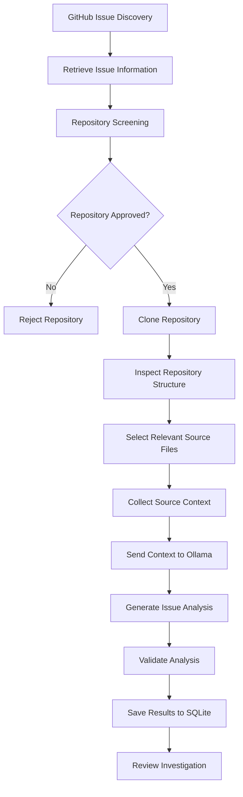

# AutoIssueHunter

**Discover open-source contribution opportunities. Investigate GitHub issues. Find your next meaningful contribution with AI.**

AutoIssueHunter is an AI-powered Python tool designed to help developers find interesting open-source issues that match their skills and experience.

It combines GitHub issue discovery, repository screening, source-code inspection, and locally hosted Large Language Models (LLMs) to investigate issues and generate actionable technical analysis.

Instead of spending hours browsing repositories and trying to understand whether an issue is worth tackling, AutoIssueHunter helps you understand the problem, explore the relevant code, identify potential root causes, and plan a possible solution.

The project uses [GitHub](https://github.com/) as its issue and repository source and [Ollama](https://ollama.com/) to run AI models locally.

---

## ✨ Features

### 🔎 GitHub Issue Discovery

- Search for open GitHub issues using GitHub's Search API.
- Filter issues using GitHub search qualifiers, such as programming language and labels.
- Exclude pull requests from search results.
- Exclude issues that already have a linked pull request.
- Retrieve issue descriptions, labels, repository information, and timestamps.
- Support paginated issue searches.

### 🛡️ Repository Screening

Before investigating an issue, AutoIssueHunter evaluates its repository against configurable project-quality criteria.

The current screening policy checks:

- Repository age (at least 90 days).
- Repository popularity (at least 50 stars).
- Recent activity (activity within the last 730 days).
- Repository size (maximum 100 MB, to prefer manageable mid-sized codebases).
- Repository availability (not archived or disabled).
- Repository type (forks are rejected).
- Availability of a default branch.

Screening results are stored locally and cached for 24 hours to avoid unnecessary GitHub API requests.

Repositories can receive one of three screening statuses:

| Status | Description |
|---|---|
| `approved` | Repository passed the screening checks. |
| `rejected` | Repository failed one or more checks. |
| `needs_review` | Repository requires additional review. |

Only approved repositories can proceed to cloning and AI analysis.

### 🤖 AI-Powered Issue Investigation

AutoIssueHunter uses locally hosted LLMs through Ollama to investigate GitHub issues.

For each approved issue, it can generate:

- **Issue summary:** A concise explanation of the problem.
- **Suspected root cause:** A potential explanation based on available evidence.
- **Investigation notes:** Relevant technical observations.
- **Relevant files:** Source files identified during investigation.
- **Relevant components:** Potentially affected project components.
- **Difficulty estimation:** Beginner, intermediate, or advanced.
- **Time estimation:** An approximate implementation effort.
- **Suggested changes:** Potential modifications to address the problem.
- **Regression tests:** Tests that should be added or executed.
- **Implementation plan:** A structured approach to solving the issue.
- **Risks:** Potential complications or side effects.
- **Confidence score:** An indication of how strongly the available evidence supports the analysis.

The analyzer distinguishes between confirmed findings and hypotheses, helping developers understand what is known and what still needs investigation.

### 📂 Repository Inspection

AutoIssueHunter can clone and inspect approved public GitHub repositories.

Repository inspection includes:

- Cloning repositories using Git.
- Updating existing local clones.
- Discovering source files.
- Identifying project configuration files.
- Detecting the primary programming language.
- Selecting potentially relevant source files based on issue descriptions.
- Reading source files for AI investigation.

Repository source code is never executed as part of the inspection process.

### 💾 Local Persistence

All application data is stored locally using SQLite.

The database maintains:

- Repository metadata.
- Repository screening decisions.
- Discovered GitHub issues.
- AI-generated issue analyses.
- Analysis history.

Previously generated analyses can be reused instead of unnecessarily invoking the LLM again.

### 🔒 Local AI Processing

AutoIssueHunter integrates with Ollama rather than requiring a cloud-based AI API.

This allows developers to use locally installed models, control their model selection, and keep issue investigation requests within their local Ollama environment.

---

## 🏗️ Architecture

AutoIssueHunter is organized into separate modules, each responsible for a specific part of the workflow.

```text
AutoIssueHunter/
│
├── issuehunter/
│   ├── llm/
│   │   └── client.py
│   ├── cli.py
│   │
│   ├── analysis.py
│   ├── config.py
│   ├── github_client.py
│   ├── models.py
│   ├── repository.py
│   ├── repository_policy.py
│   └── storage.py
│
├── tests/
│
├── data/
│
├── workspace/
│
├── .env.example
├── pyproject.toml
└── README.md
```

### Main Components

| Component | Responsibility |
|---|---|
| `github_client.py` | Communicates with the GitHub REST API and retrieves issues. |
| `repository_policy.py` | Screens repositories before further processing. |
| `repository.py` | Clones, inspects, and reads repository source files. |
| `analysis.py` | Coordinates AI-powered issue investigation. |
| `llm/client.py` | Communicates with Ollama. |
| `storage.py` | Manages SQLite persistence and caching. |
| `models.py` | Defines application data models and validation. |
| `config.py` | Loads and validates application configuration. |

---

## 🔄 How It Works

The general investigation workflow is:



The process is designed to reduce unnecessary repository cloning and LLM requests by screening repositories and reusing cached information and existing analyses.

---

## 🛠️ Technology Stack

| Technology | Purpose |
|---|---|
| Python 3.11+ | Main programming language |
| GitHub REST API | Issue discovery and repository metadata |
| Ollama | Local LLM inference |
| Qwen 2.5 Coder | Default AI model |
| SQLite | Local database |
| HTTPX | HTTP communication |
| Pydantic | Data validation and configuration |
| Pydantic Settings | Environment-based configuration |
| Typer | CLI framework dependency |
| Rich | Terminal output dependency |
| Pytest | Testing |
| Ruff | Linting and formatting |

---

## 🚀 Getting Started

### Prerequisites

Before installing AutoIssueHunter, make sure you have:

- Python 3.11 or newer.
- Git installed and available in your PATH.
- [Ollama](https://ollama.com/download) installed.
- A compatible Ollama model downloaded.

### 1. Clone the repository

```bash
git clone https://github.com/spenam/AutoIssueHunter.git

cd AutoIssueHunter
```

### 2. Create a virtual environment

```bash
python -m venv .venv
```

Activate it:

**Linux / macOS**

```bash
source .venv/bin/activate
```

**Windows (PowerShell)**

```powershell
.venv\Scripts\Activate.ps1
```

### 3. Install dependencies

Install AutoIssueHunter in editable mode:

```bash
pip install -e .
```

For development and testing:

```bash
pip install -e ".[dev]"
```

### 4. Configure Ollama

Start Ollama and download the default model:

```bash
ollama pull qwen2.5-coder:7b
```

Make sure the Ollama service is accessible at:

```text
http://localhost:11434
```

You can use another compatible model by changing the configuration.

### 5. Configure environment variables

Create your local environment file:

```bash
cp .env.example .env
```

On Windows:

```powershell
Copy-Item .env.example .env
```

Edit `.env` to configure the application.

### 6. Use the CLI

The `issuehunter` command exposes the local discovery and investigation workflow:

```bash
# Find open issues and screen their repositories
issuehunter discover --language python --label bug --limit 10

# Review saved issues and repository decisions
issuehunter issues
issuehunter repositories --status approved

# Screen a repository explicitly, then analyze a saved issue
issuehunter screen pallets/flask
issuehunter analyze 123456789

# Verify the local database
issuehunter health
```

Use `--help` with the command or any subcommand to see all available options.

---

## ⚙️ Configuration

AutoIssueHunter uses environment variables and a `.env` file for configuration.

| Variable | Default | Description |
|---|---|---|
| `GITHUB_TOKEN` | Empty | Optional GitHub personal access token. |
| `GITHUB_API_URL` | `https://api.github.com` | GitHub API endpoint. |
| `OLLAMA_BASE_URL` | `http://localhost:11434` | Ollama service URL. |
| `OLLAMA_MODEL` | `qwen2.5-coder:7b` | LLM used for issue investigation. |
| `DATABASE_PATH` | `data/issuehunter.sqlite3` | SQLite database location. |
| `WORKSPACE_PATH` | `workspace/` | Local repository workspace. |
| `LOG_LEVEL` | `INFO` | Application logging level. |
| `REQUEST_TIMEOUT` | `30` | HTTP request timeout in seconds. |
| `DEFAULT_LANGUAGE` | `python` | Default programming language preference. |
| `DEFAULT_DEVELOPER_LEVEL` | `intermediate` | Default developer experience level. |
| `MAX_ISSUES_PER_SCAN` | `50` | Maximum configured issues per scan. |

### GitHub Token

A GitHub token is optional, but recommended to benefit from higher API rate limits.

You can create one in your GitHub account under:

[GitHub Developer Settings → Personal Access Tokens](https://github.com/settings/personal-access-tokens)

Store your token in `.env`:

```env
GITHUB_TOKEN=your_github_token
```

Never commit your `.env` file or expose your token publicly.

---

## 🧪 Development and Testing

AutoIssueHunter uses Pytest for automated testing.

Run the test suite:

```bash
pytest
```

Run tests with coverage:

```bash
pytest --cov=issuehunter --cov-report=term-missing
```

Run Ruff:

```bash
ruff check .
```

Format the code:

```bash
ruff format .
```

---

## 🔐 Security Considerations

AutoIssueHunter interacts with external repositories and uses LLMs to process issue descriptions and source code.

Several safeguards are implemented:

- Repository names are validated before Git operations.
- Only repositories that pass screening can be cloned and analyzed.
- Git operations use HTTPS and disable interactive prompts.
- Git hooks are disabled during repository operations.
- Submodules are not initialized.
- Repository code is not executed during inspection.
- Symbolic links and unsafe file paths are rejected during inspection.
- Source files have individual and aggregate size limits.
- Issue descriptions and repository files are treated as untrusted input by the AI analyzer.
- AI-generated file references are validated against inspected source files.
- Analysis results are validated using Pydantic models.

**Important:** AI-generated investigations are suggestions, not verified fixes. Developers should independently review the findings, inspect the source code, and run appropriate tests before submitting changes.

---

## 🚧 Project Status

<details>
<summary>Current development status</summary>

AutoIssueHunter is currently in an early development stage (Alpha).

The repository contains the foundational components for:

- GitHub issue retrieval.
- Repository eligibility screening.
- Repository cloning and inspection.
- Local LLM integration.
- AI-powered issue analysis.
- SQLite persistence.
- Automated testing.

The project is still evolving, and its functionality and interfaces may change.

</details>

---

## 🗺️ Roadmap

Potential areas for future development include:

- [ ] Complete an end-to-end issue discovery and investigation workflow.
- [ ] Developer profile and skill-based issue matching.
- [ ] More advanced contribution opportunity ranking.
- [ ] Improved issue complexity and effort estimation.
- [ ] Support for additional LLM providers and models.
- [ ] Better repository and issue filtering.
- [ ] Improved terminal interface and reporting.
- [ ] Export investigations to Markdown and HTML.
- [ ] Track contribution progress and investigation history.
- [ ] Detect duplicate or related GitHub issues.
- [ ] Improve automated test coverage.
- [ ] Provide more detailed evidence and source-code references.

---

## 🤝 Contributing

Contributions are welcome!

If you have ideas, bug reports, or improvements, feel free to participate.

1. Fork the repository.
2. Create a feature branch.

   ```bash
   git checkout -b feature/my-feature
   ```

3. Implement your changes.
4. Run the tests.

   ```bash
   pytest
   ```

5. Commit your changes.

   ```bash
   git commit -m "Add my feature"
   ```

6. Push your branch.

   ```bash
   git push origin feature/my-feature
   ```

7. Open a Pull Request.

Please keep contributions focused, tested, and consistent with the existing code style.

---

## 📄 License

This project is licensed under the MIT License.

See the [LICENSE](LICENSE) file for details.

---

## ⭐ Support the Project

If you find AutoIssueHunter interesting or useful:

- Give the repository a ⭐ on GitHub.
- Report bugs and suggest improvements.
- Contribute code and documentation.
- Share the project with other developers interested in open source.

**Repository:** https://github.com/spenam/AutoIssueHunter

---

*Find the issue. Understand the code. Make your next contribution count.*